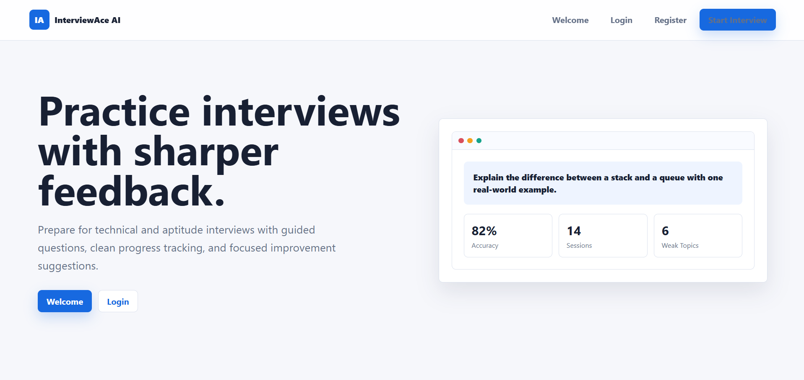
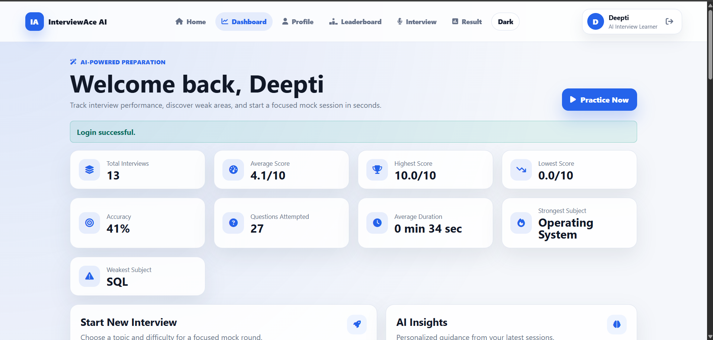
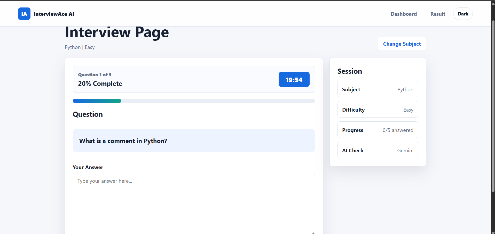
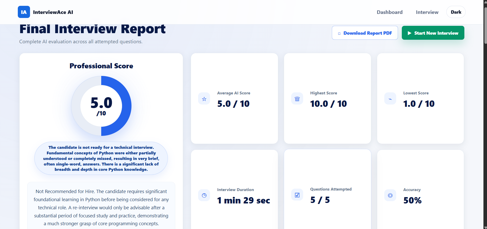
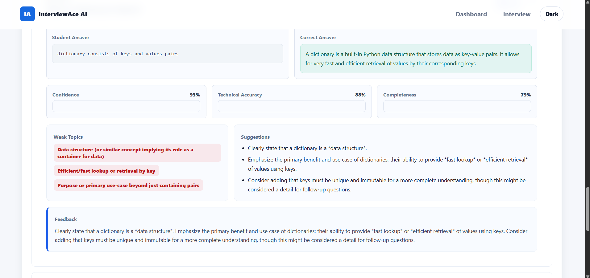
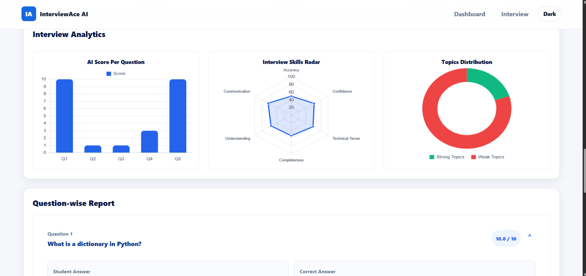

# 🤖 InterviewAce AI

<p align="center">

### AI-Powered Interview Preparation & Evaluation Platform

An intelligent mock interview platform built using **Flask**, **Google Gemini AI**, **Machine Learning**, and **MySQL** that helps students prepare for technical interviews through AI-based evaluation, detailed analytics, and personalized learning recommendations.

</p>

---

## 🚀 Overview

InterviewAce AI simulates real technical interviews by asking subject-specific questions and evaluating candidate responses using **Google Gemini AI** along with a **Machine Learning model**.

The platform provides detailed feedback, performance analytics, AI-generated suggestions, and personalized learning paths to help users improve their interview skills.

---

# ✨ Features

### 🎤 AI Mock Interview

- User Registration & Login
- Subject-wise Interview Selection
- Difficulty Levels (Easy, Medium, Hard)
- Random Question Generation
- Timed Interview Sessions
- Real-time Progress Tracking

---

### 🤖 Gemini AI Evaluation

- AI-generated Answer Evaluation
- Score out of 10
- Missing Concepts Detection
- Correct Answer Generation
- Improvement Suggestions
- Personalized Feedback

---

### 🧠 Machine Learning Integration

- TF-IDF Vectorizer
- Random Forest Classifier
- Answer Quality Prediction

Prediction Categories:

- ⭐ Excellent
- ✅ Good
- 🟡 Average
- 🟠 Poor
- 🔴 Very Poor

The predicted class and confidence score are stored and displayed in the final report.

---

### 📊 Performance Analytics

- Overall Interview Score
- Accuracy Analysis
- Confidence Score
- Completeness
- Technical Terms Used
- Weak Topics Identification
- Learning Recommendations

Interactive Charts

- 📈 Bar Chart
- 📊 Radar Chart
- 🍩 Doughnut Chart

---

### 📄 Detailed Interview Report

Each interview generates a complete AI report containing:

- AI Evaluation
- Correct Answer
- Missing Concepts
- Suggestions
- Confidence Score
- Technical Accuracy
- Personalized Learning Path
- Strengths & Weaknesses

---

# 🛠 Tech Stack

## Frontend

- HTML5
- CSS3
- JavaScript
- Bootstrap 5
- Chart.js

## Backend

- Python
- Flask

## Artificial Intelligence

- Google Gemini API

## Machine Learning

- Scikit-Learn
- Random Forest Classifier
- TF-IDF Vectorizer
- Pandas
- NumPy

## Database

- MySQL

---

# 📸 Project Screenshots

## 🏠 Landing Page

<p align="center">

</p>

---

## 📊 Dashboard

<p align="center">

</p>

---

## 🎤 Interview Interface

<p align="center">

</p>

---

## 🤖 AI Evaluation Report

<p align="center">

</p>

---

## 📝 Question-wise Evaluation

<p align="center">

</p>

---

## 📈 Analytics Dashboard

<p align="center">

</p>

---

# 📂 Project Structure

```text
InterviewAce-AI/
│
├── app.py
├── config.py
├── requirements.txt
├── setup_database.py
│
├── assets/
│   ├── landing-page.png
│   ├── dashboard.png
│   ├── interview-page.png
│   ├── final-report.png
│   ├── question-evaluation.png
│   └── analytics.png
│
├── database/
│   └── database.sql
│
├── models/
│   ├── interview_model.pkl
│   ├── vectorizer.pkl
│   └── labels.pkl
│
├── services/
│   ├── ai.py
│   └── ml_model.py
│
├── static/
├── templates/
└── README.md
```

---

# ⚙️ Installation

### Clone the Repository

```bash
git clone https://github.com/Niyati-Mahajan/InterviewAce-AI.git
```

### Move into the Project

```bash
cd InterviewAce-AI
```

### Install Dependencies

```bash
pip install -r requirements.txt
```

### Configure Environment Variables

Create a `.env` file and add:

```env
MYSQL_HOST=localhost
MYSQL_USER=root
MYSQL_PASSWORD=your_password
MYSQL_DATABASE=InterviewAI

GEMINI_API_KEY=YOUR_GEMINI_API_KEY
GEMINI_MODEL=gemini-2.5-flash
```

### Setup Database

Run:

```bash
python setup_database.py
```

or execute

```
database/database.sql
```

inside MySQL.

### Run the Application

```bash
python app.py
```

Open:

```
http://127.0.0.1:5000
```

---

# 🌟 Future Enhancements

- 🎙 Voice-based Interview
- 📄 Resume Analyzer
- 📈 ATS Resume Scoring
- 😊 Face Emotion Detection
- 💻 Coding Interview Evaluation
- 🌍 Multi-language Interview Support
- 🏆 Leaderboard
- 👨‍💼 Admin Dashboard
- 📚 Interview History

---

# 👩‍💻 Developer

**Niyati Mahajan**

**B.Tech – Computer Science & Engineering (AI & ML)**

GitHub: https://github.com/Niyati-Mahajan

---

# ⭐ Show Your Support

If you found this project useful, consider giving it a **⭐ Star** on GitHub.

It motivates me to build more AI-powered projects and continue learning!
